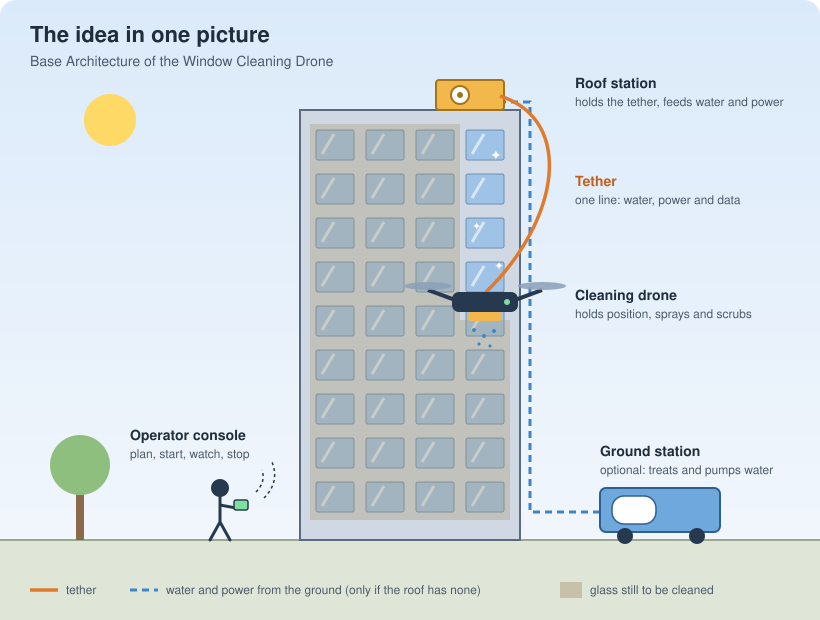
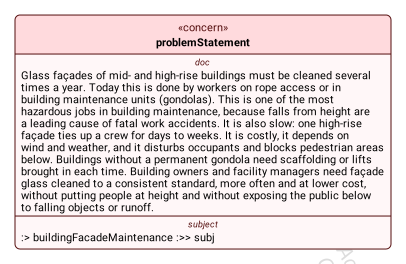
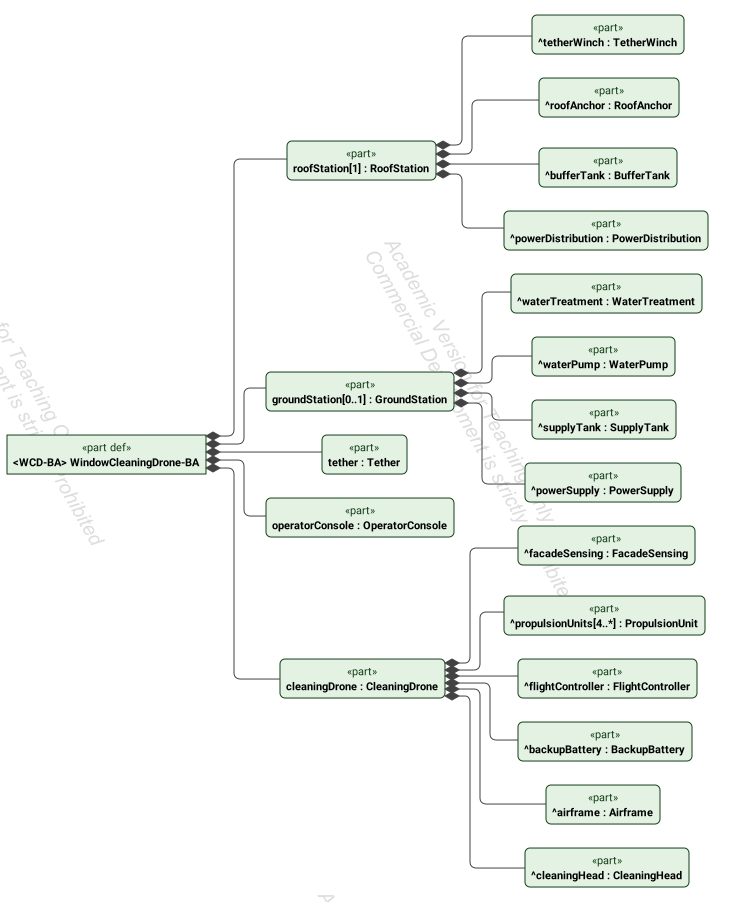

# Clean glass, nobody at height

*The story of the Window Cleaning Drone, told from its system model. No modeling knowledge needed.*

> [!TIP]
> **📅 Next workshop:** [LINK TO NEXT WORKSHOP](#) · Trainings: [English](https://www.oose.com/topics/systems-engineering) · [Deutsch](https://www.oose.de/unsere-themen/systems-engineering)

---

## Chapter 1: Thirty floors up, before breakfast

It is seven in the morning in front of an office tower. Thirty floors up, a window cleaner clips into a rope and steps over the edge of the roof. Below, a section of the pavement is fenced off, so that nobody walks under a dropped bucket or a sheet of dirty water.

This scene repeats on hotels and office buildings everywhere, several times a year, because glass façades get dirty and someone has to clean them. And it is a hard job in every sense:

- **It is dangerous.** Falls from height are a leading cause of fatal work accidents, and façade cleaning puts people at height all day.
- **It is slow.** One high-rise façade keeps a crew busy for days, sometimes weeks.
- **It is expensive,** and it stops whenever the wind picks up or the weather turns.
- **It disturbs everyone around it.** Occupants have someone at their window, and the area below has to be closed off.
- **Not every building is ready for it.** Buildings without a permanent gondola need scaffolding or a lift brought in, every single time.

What building owners and facility managers actually want is simple to say: **glass cleaned to the same standard every time, more often, for less money, without putting people at height, and without anything falling on the public below.**

That sentence is where our model starts. In the model it is called the *problem statement*, and it looks like this:

The red box is the model's way of saying *this is a concern*: something that matters and that the system has to answer to. It is about one thing, written at the bottom of the box: **building façade maintenance**, meaning the recurring cleaning of glass façades on mid- and high-rise buildings (offices and hotels, 5 to 40 floors), together with the people who order it, do it, and live with it.

Everything we add to the model from here on has to trace back to this box. If a part of the system does not help solve this problem, it does not belong in it.

## Chapter 2: What if nobody had to go up there?

The idea is to send a drone instead of a person. But a drone that cleans windows is not the same as a drone that takes photos. It has to carry water, stay in front of a wall for hours, and never, ever fall on someone. So the idea quickly became more than "a drone". It became a small team of five members, each with a clear job.

| Team member | Its job, in one line |
|---|---|
| 🚁 **The cleaning drone** | Holds its position in front of the façade and cleans the glass. |
| 🔗 **The tether** | One single line between the roof and the drone that carries purified water, electrical power and data. |
| 🏗️ **The roof station** | Everything that has to be *above* the drone: it holds the tether's weight, lets it out and reels it in, and feeds water and power into it. Exactly one per job. |
| 🚚 **The ground station** | The heavy equipment, parked where there is mains water, a drain and room for a vehicle. It cleans the water and sends water and power up to the roof. **Optional:** only needed when the roof has no clean water and power of its own. |
| 📱 **The operator console** | The tablet or remote the operator uses to plan a cleaning job, start it, watch it and stop it. |

In the model, this team is called the **Base Architecture**: the first, rough decomposition of the system that every later step will refine.

## Chapter 3: A look inside

Each team member has its own parts. Here is the complete picture as the model holds it today. Read it from left to right: the whole system on the left, its five members in the middle, and what each member is made of on the right.

### Inside the drone

| Part | What it does |
|---|---|
| Airframe | Carries everything else and the tether attachment. It has **guards around the propellers.** |
| Propulsion units (at least four) | One motor and one propeller each. Together they lift the drone and move it. |
| Flight controller | Keeps the drone stable and on its cleaning path. |
| Façade sensing | Measures the distance to the glass and where the drone is on the façade. It also spots **opened windows and people** in front of the drone. |
| Cleaning head | Sprays purified water on the glass and scrubs it with a brush. |
| Backup battery | Holds enough energy for a **controlled landing** if the supply through the tether ever fails. It recharges from the tether in flight. |

### Inside the roof station

| Part | What it does |
|---|---|
| Tether winch | Lets the tether out and reels it back in as the drone moves. |
| Roof anchor | Fixes the station to the building and carries the tether's weight. |
| Buffer tank | Keeps a reserve of purified water **above** the drone. |
| Power distribution | Feeds electrical power into the tether. |

### Inside the ground station (when there is one)

| Part | What it does |
|---|---|
| Water treatment | Purifies mains water so the glass dries **without spots and without detergent.** |
| Supply tank | Stores the purified water at ground level. |
| Water pump | Lifts the water up to the roof station. |
| Power supply | Provides electrical power from the mains or a generator. |

## Chapter 4: Why it looks like this

A list of parts tells you *what* is there. The interesting part is *why*. Several decisions are already visible in the model, and each one goes back to the problem in Chapter 1.

**Why a tether instead of a battery-powered drone?**
Water is heavy and batteries run out. A drone that had to carry its own water and energy would spend most of its time flying back and forth to refill. The tether brings water, power and data in one line, so the drone can keep working.

**Why put the water tank on the roof?**
Because water flows down by itself. A tank *above* the drone means gravity supplies the water pressure, so the drone does not have to carry a pump for it.

**Why is the ground station optional?**
Many buildings already have water and power on the roof. For them, the ground station would be heavy equipment that nobody needs. The model says it explicitly: *zero or one* ground station, but always exactly one roof station.

**Why purified water and no soap?**
Purified water dries without leaving spots, so no detergent is needed. That is also good news for the people walking below, and for the drain.

**Why the backup battery, the propeller guards, and the sensing for people and open windows?**
Because the whole point of the system is to stop putting people at risk. A cleaning drone that endangers occupants or pedestrians would just move the danger from the window cleaner to someone else. Safety shows up in the parts list from day one, not as an afterthought.

## Chapter 5: Why a model, and not just a drawing?

Every picture in this story comes from one **system model** written in SysML v2, the new international standard for describing technical systems. The difference to a drawing is that the model *knows* things. It knows that the ground station is optional, that the drone has at least four propulsion units, and that the problem statement is about building façade maintenance. The diagrams are views on that knowledge, generated from it, so they cannot drift apart from each other.

That matters more and more as the system grows. Later, when we write requirements like "the drone must land safely if the tether supply fails", the model will be able to show which part takes care of it (the backup battery) and which problem it answers (people at height and the public below).

## To be continued

We are at the start of the story. The problem is clear and the idea has a shape. The next sessions will ask:

- **Who cares?** Building owners, facility managers, the operator, occupants, passers-by, and maybe some we have not thought of yet. Who matters most, and why?
- **What do they need?** Each in their own words.
- **What must the drone actually do,** and how well?
- **What does it touch** at its boundary: the building, the weather, the people, the water supply?

Each answer will be added to the model and to this story.

Have a question or a doubt? Something that seems missing, or something that seems too good to be true? [Open an issue](https://github.com/oose/SysML-2-Models/issues). The best questions become the starting point for the next session.

> [!CAUTION]
> ### P.S. Everything you just read took 1.5 hours of work
>
> The model behind this story was built in **less than 1 hour** during the workshop, then **reviewed by oose SysML v2 experts in 30 minutes** afterwards.
>
> It was generated with **AI as an assistant**: the AI wrote the model, people decided what goes in and checked that every part is right. That is the point of the workshop: stop prompting and hoping, start engineering with AI doing the heavy lifting.
>
> Want to work like this in your own projects? See our trainings: [English](https://www.oose.com/topics/systems-engineering) · [Deutsch](https://www.oose.de/unsere-themen/systems-engineering)

---

*Built live in the workshop **Stop Prompting, Start Engineering**. See the [README](README.md) for how to follow along.*
